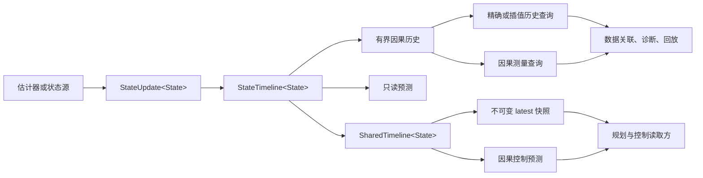

# Unified State

作者:成都大学Ultra-pawpaw

统一状态架构是从ultra_vision_27独立出的单独模块，显式维护不同模型。

**目的:Unified State 是一个 C++17、纯头文件的状态发布与历史查询基础库，用于把估计器输出放到一条具备因果语义的时间轴上。它面向需要共享同一份状态历史的系统，例如数据关联、规划、控制、诊断、回放和日志。**

本库与具体估计器无关，不包含 EKF、FGO、装甲模型、检测器、相机模型、OpenCV、Eigen、ROS 或任何项目专用状态定义。调用方负责定义 `State`，Unified State 负责状态的时序、历史和发布契约。

> Unified State 是状态契约与历史管理层，不是另一个估计器。

## 为什么需要这一层

只在模块之间传递“最新结构体”通常不够。消费者还需要知道：

- 这份状态描述的是哪个物理时刻；
- 复现该状态所需的全部信息在什么时刻才真正可用；
- 状态来自观测支持的后验、仅运动传播，还是只读预测；
- 状态属于哪一次跟踪会话；
- 状态来自哪个源修订号以及哪一次 reset 生命周期；
- 一次历史查询用于离线分析还是在线因果查询；
- 未来状态由哪个预测模型产生。

当这些信息没有显式建模时，各模块容易给同一份状态打上不同时间戳、使用尚未可用的结果、把预测结果重新当作观测历史，或者在不同目标之间进行插值。Unified State 将这些失败模式转换为明确约束，并通过测试验证。

## 架构



数据路径由一个写入模型和两类查询模型组成：

1. **已记录历史**：在同一个跟踪会话内，按物理事件时间严格有序、只追加、有容量上限。
2. **只读派生**：插值和预测结果按需生成，不会写回历史。
3. **快照发布**：为单写多读场景提供一致且不可变的 latest 状态，读取方不直接访问历史容器。

## 核心契约

### `Timestamp`

```cpp
struct Timestamp {
    std::int64_t nanoseconds;
    ClockDomain clock;
};
```

时间由整数纳秒和调用方定义的时钟域组成。本库不会主动调用系统时钟。不同时钟域之间不能直接比较，否则返回 `QueryError::clock_mismatch`。

### `StateUpdate<State>`

```cpp
template<class State>
struct StateUpdate {
    Timestamp state_time;
    std::optional<Timestamp> available_time;
    SessionKey session;
    State state;
    bool measurement_backed;
    int coast_frames;
};
```

`state_time` 是该状态描述的物理时刻。`available_time` 是复现该状态所需的全部输入第一次真正可用的时刻。若未提供，则默认等于 `state_time`；在线管线通常应显式填写实际可用时间。

`measurement_backed` 是上游给出的明确断言：状态受到当前观测支持。仅运动传播的状态应将其设为 `false`。

### `State`

`State` 是调用方定义、可拷贝且可移动的值类型，可以包含：

- 均值和协方差；
- 离散的物理身份或槽位假设；
- 观测质量元数据；
- 坐标系标识；
- 估计器专用的几何量。

Unified State 只负责存储和返回 `State`，不会解释或修改其中的数值。因此，角度归一化、协方差约定和状态传播必须由调用方提供的策略或适配器实现。

### `SessionKey`

```cpp
struct SessionKey {
    std::uint64_t value;
    std::uint32_t domain;
    bool valid;
};
```

Session 表示一次连续、没有发生重置的跟踪过程。`domain` 用于隔离不同子系统产生的相同数值。

检测类别 ID、装甲编号或相对槽位标签都不能直接作为 session key。本库可以阻止隐式 session 切换，但无法决定两个观测是否属于同一个物理对象；这仍然属于上游数据关联的职责。

### `StateSnapshot<State>`

快照在状态值之外保留来源信息：

```text
state_time        状态所描述的物理时刻
anchor_time       预测使用的锚点，或插值使用的上界记录
available_time    来源记录的信息可用时间
revision          来源记录的修订号，不是派生结果的新修订号
epoch             reset 生命周期编号
source            posterior | motion_only | interpolated | predicted
session           跟踪会话身份
measurement_backed
coast_frames
state             调用方定义的状态值
```

预测和插值都是查询时生成的派生结果，不会追加到历史，也不会消耗新的 `revision`。

## 时间轴保证

在同一个 `StateTimeline` 内：

- `state_time` 必须严格递增；
- 记录更新时，`available_time` 不能早于 `state_time`；
- 一条时间轴只能有一个活动时钟域和一个活动 session；
- 时钟域或 session 发生变化时，必须显式调用 `reset()`；
- 只允许在相同 session 且不超过 `max_interpolation_gap` 的相邻记录之间插值；
- `exactAt()` 和 `interpolateAt()` 不会外推；
- 预测必须满足 `max_prediction_horizon`；
- 预测不会修改已记录历史；
- 历史长度受 `max_history` 限制；
- `reset()` 清空历史、递增 `epoch`，并从 1 重新开始 `revision`。

配置后的最大历史长度至少为 1。将 `max_history` 设为 0 等价于只保留 latest 记录。

## 查询语义

不同消费者需要不同的“在目标时刻或之前”定义。

| API | 事件时间规则 | 可用时间规则 | 典型用途 |
| --- | --- | --- | --- |
| `exactAt(t)` | 精确等于 `t` | 不检查 | 确定性回放和调试 |
| `interpolateAt(t)` | 使用两侧包围记录 | 不检查 | 离线分析 |
| `measurementAtOrBefore(t, age)` | 事件时间 `<= t` | 不检查 | 离线数据关联 |
| `causalMeasurementAtOrBefore(now, age)` | 事件时间 `<= now` | `available_time <= now` | 在线数据关联 |
| `predictAt(t)` | 锚点事件时间 `<= t` | 不检查 | 规划或离线预测 |
| `predictForControl(now, latency)` | 使用 latest 锚点 | 不检查 | 延迟补偿查询 |
| `predictCausallyForControl(now, age, latency)` | 使用 latest 测量锚点 | 必须在 `now` 前可用 | 在线控制 |

`predictCausallyForControl()` 使用最近一次受观测支持的状态作为锚点。较新的仅运动传播状态可以通过 `latest()` 看到，而最近一次观测锚点仍可通过 `latestMeasurement()` 获取。输出状态预测到 `now + downstream_latency`，且下游延迟只累加一次。

对于预测快照，`state_time` 可能晚于 `available_time`。这是有意设计的：预测所表示的未来物理时刻，与生成该预测的输入首次可用时刻并不是同一个概念。

## 错误语义

查询返回 `QueryResult<State>`，调用方可以区分普通的数据不存在与契约错误：

- `invalid_input`
- `clock_mismatch`
- `empty_timeline`
- `before_oldest` / `after_newest`
- `exact_sample_not_found`
- `interpolation_gap_exceeded`
- `session_mismatch`
- `non_monotonic_state_time`
- `model_unavailable`
- `prediction_horizon_exceeded`
- `prediction_before_anchor`
- `future_available`
- `measurement_not_found`
- `anchor_too_old`

`toString(QueryError)` 主要用于日志和测试。

## 插值与预测

模型通过函数注入：

```cpp
TimelinePolicy<State> policy;
policy.interpolate = [](const State& a, const State& b, double alpha)
    -> std::optional<State> { /* 调用方模型 */ };
policy.predict = [](const State& anchor, Nanoseconds dt)
    -> std::optional<State> { /* 调用方模型 */ };
```

这样可以把坐标约定、yaw 环绕、协方差传播和过程噪声保留在本库之外。策略可以返回 `std::nullopt`，表示当前模型无法回答该查询。

`TimelinePolicy` 中的模型名称字符串只用于描述策略，Unified State 不会解释这些字符串。

## 并发模型

`StateTimeline<State>` 内部不提供同步保护，适用于单线程所有者，或由调用方自行提供同步。

`SharedTimeline<State>` 提供单写多读发布：

- 只能由同一个写线程调用 `record()` 和 `reset()`；
- 任意多个线程可以调用 `latest()`、`latestMeasurement()`、`predictAt()`、`predictCausallyForControl()` 和元数据读取接口；
- 读取方获得 `std::shared_ptr<const StateSnapshot<State>>`；
- 写方发布不可变快照，读取方不会访问历史 deque；
- 对测量支持的快照，先发布测量锚点，再发布 latest，避免读取方看到“latest 已存在但测量锚点尚未发布”的首次发布窗口。

原子 `shared_ptr` 操作具备线程安全性，但 C++ 标准不保证其底层实现是无锁的。读取方持有快照期间，会保持该快照对象的生命周期。

`State` 不应隐藏被多个快照共享且可变的存储。应使用值语义或不可变共享载荷，确保快照发布后不会被修改。

## 身份与语义歧义

本库把时间/会话身份与业务领域身份分开：

```text
SessionKey                 一次跟踪会话
State                      调用方定义的物理身份与假设
StateSource                粗粒度来源类别
measurement_backed         是否有观测支持
TimelinePolicy             插值与预测规则
```

这个边界是有意保留的。数值类别 ID 可以说明目标属于哪个兵种，但不能说明当前看到的是前、后、左、右哪一块物理装甲板。同样，相对模型槽位可以作为诊断信息，但不应被当作稳定的目标身份。

如果应用存在多个物理槽位假设，应将这些假设以离散形式保存在 `State` 或外层模块中。Unified State 不会把它们隐式压缩为一个连续权重。观测与物理对象的关联、证据保留以及分支仲裁仍由调用方的数据关联层负责。

每个活动物理目标应拥有独立的时间轴。目标切换必须显式创建新时间轴，或调用 `reset(ResetReason::session_switch)`，不能在 `record()` 中隐式完成。

## 接入状态源

适配器只需要转换一次估计器结果：

```text
ExternalEstimate
    -> StateUpdate<State>
    -> StateTimeline::record()
```

适配器应完成以下工作：

1. 保留真实的事件时间和信息可用时间；
2. 分配有意义的 session key；
3. 拷贝需要的均值、协方差和领域元数据；
4. 明确说明当前结果是否受观测支持；
5. 在记录前只做一次坐标转换。

消费者应从统一时间轴查询状态，而不是各自缓存一份没有时间语义的云台、火控或目标状态。离线算法使用离线查询接口，在线数据关联必须使用因果查询接口。

### 接入后可以获得的收益

主要收益来自架构和运行时语义：

- **统一时间契约**：所有消费者使用相同的事件时间、可用时间、来源、修订号和 reset epoch。
- **保证在线因果性**：在线查询不能使用查询时刻尚未可用的状态。
- **显式目标生命周期**：revision 和 epoch 使 reset、目标切换和旧状态失效变得可见。
- **可回放历史**：在线消费者和离线分析使用同一份有界记录及相同的查询约束。
- **收窄消费者契约**：适配器只暴露消费者需要的量，避免整个估计器对象泄漏到所有模块。
- **更轻的多读取方交接**：不可变快照读取避免每个消费者都深拷贝控制载荷或完整历史。
- **增强诊断能力**：查询错误可以区分锚点过期、未来信息、模型缺口和会话不匹配。

它本身不会提高原始传感器帧率、检测精度、数据关联精度或物理装甲槽位的可观测性。

## 关于 11 维状态到 8 维状态的投影

Unified State 不会把 11 维估计器转换成 8 维估计器。调用方适配器可以在快照边界对选定子空间做投影，例如：

```text
mu8      = S * mu11
Sigma8   = S * Sigma11 * S^T
```

如果 `S` 是线性选择矩阵，那么在该快照时刻，选定的均值和边缘协方差是精确的。这种方式不引入第二个滤波器，也不会虚构源估计器没有提供的协方差。

但这不意味着 8 维预测器在所有情况下都与 11 维预测器等价。被删除的几何量可能影响后续传播、插值和过程噪声。等价性与精度必须通过相同输入的逐帧回放 A/B 实验验证。

可以成立的表述是：

> 状态投影可以在快照时刻保持所选边缘量不变，同时收窄消费者契约和数据规模。

不能直接成立的表述是：

> 用投影替代原估计器后，所有未来预测都必然零精度损失。

## 参考性能数据

以下结果来自单台主机，仅作为参考，不代表跨平台保证，也不代表最坏情况。

### 独立库

环境为 Apple M1 ARM64、macOS 26.4.1、Apple Clang 21、Release（`-O3`），连续运行三次。负载状态包含 8 个 `double` 状态量和 64 个协方差元素。下表为每次操作的 P95。

| 操作 | P95 |
| --- | ---: |
| 时间轴记录 | 0.125-0.209 us |
| 精确历史查询 | 0.042 us |
| 插值历史查询 | 0.042 us |
| +50 ms 预测 | 0.042 us |
| 共享快照发布 | 0.167 us |
| 原子 latest 读取 | 0.042 us |
| 因果控制预测 | 0.042 us |

计时器分辨率约为 41.7 ns，因此 0.042 us 附近的结果表示“一到两个计时器刻度”，不应被解释为精确到纳秒的硬件延迟。

### C++ 跟踪系统探索性 A/B

我们曾在独立影子分支中接入一个现有的 11 维目标估计器。该实验没有把任何项目代码合并到本仓库，也没有替换原系统的估计器或控制输出。旧控制邮箱在 mutex 下拷贝目标容器，实验路径则发布一个不可变载荷。

环境为 Apple M1 ARM64、Release，连续运行三次，P95：

| 操作 | 原 mutex + 拷贝路径 | 不可变快照路径 |
| --- | ---: | ---: |
| 控制消息发布 | 1.17-1.67 us | 0.625 us |
| 控制消息读取 | 0.67-0.79 us | 0.042 us |

同一实验环境中，适配器加完整协方差状态记录的开销为 P95 0.334 us。控制交接每完成一次发布和读取，大约节省 1-2 us，主要来自消除读取方的深拷贝。

在 500 Hz 控制环中，周期为 2 ms。节省 1-2 us 不到周期的 0.1%，**不会明显提高控制频率**。真正的收益是确定性的时间来源和更轻的多读取方契约；只有交接位于更紧的热路径时，这部分延迟收益才更值得关注。

这些数据不能用于证明跟踪精度或火控精度得到提升。

## 构建、测试与基准

```bash
cmake -S . -B build \
  -DCMAKE_BUILD_TYPE=Release \
  -DUNIFIED_STATE_BUILD_BENCHMARKS=ON \
  -DUNIFIED_STATE_BUILD_EXAMPLES=ON
cmake --build build -j
ctest --test-dir build --output-on-failure
./build/unified_state_timeline_bench
./build/unified_state_basic_example
```

测试覆盖非法时间和时钟域、单调记录、会话隔离、有界历史、离线与因果可用性、插值间隔、预测视界、reset epoch、单写发布和并发读取一致性。

实现还通过了以下检查：

- AddressSanitizer 和 UndefinedBehaviorSanitizer；
- ThreadSanitizer；
- `-Wall -Wextra -Wpedantic -Werror`。

## 通过 CMake 安装和使用

```bash
cmake --install build --prefix /path/to/prefix
```

```cmake
find_package(unified_state CONFIG REQUIRED)
target_link_libraries(my_target PRIVATE unified_state::unified_state)
```

本库为纯头文件实现，CMake 包配置会自动导出 C++17 和 Threads 依赖。最小安装消费示例位于 [`tests/consumer/CMakeLists.txt`](tests/consumer/CMakeLists.txt)，可运行示例位于 [`examples/basic.cpp`](examples/basic.cpp)。

```cpp
#include <unified_state/timeline.hpp>

unified_state::SharedTimeline<MyState> timeline(config, policy);

unified_state::StateUpdate<MyState> update;
update.state_time = capture_time;
update.available_time = processing_finished_time;
update.session = session;
update.state = estimate;
update.measurement_backed = observed;

if (const auto result = timeline.record(std::move(update)); !result) {
    // 记录 result.error 并处理契约错误。
}
```

## 非目标

Unified State 不提供：

- 传感器融合或估计器实现；
- 数据关联或物理装甲槽位仲裁；
- 坐标变换或时间同步；
- 检测类别、装甲编号等业务 ID 的通用身份定义；
- 不依赖调用方策略的 yaw 归一化或协方差约束；
- 硬实时内存分配保证；
- 网络、序列化或存储协议；
- 火控安全门或开火决策。

默认历史容器使用 `std::deque`，扩容时可能发生动态分配。对于硬实时部署，后续可以增加固定容量环形缓冲实现。

## API 稳定性

当前版本为 `0.1.0`。在 `1.0` 之前，随着真实适配和非功能需求暴露更准确的命名或边界，源码兼容性仍可能变化。
