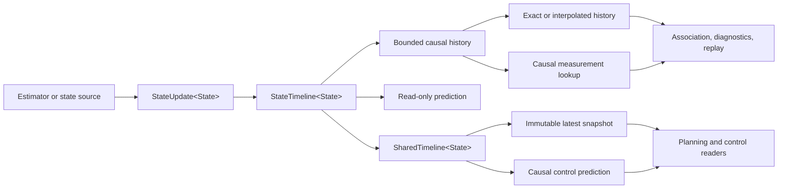

# Unified State

Unified State is a C++17, header-only library for publishing and querying
estimator output on a causally consistent timeline. It is designed for systems
where several consumers need the same state history: association, planning,
control, diagnostics, replay, and logging.

The library is estimator-agnostic. It contains no EKF, FGO, armor model,
detector, camera model, OpenCV, Eigen, ROS, or project-specific state
definition. The caller defines `State`; the timeline owns its temporal and
publication contract.

> Unified State is a state-contract and history layer, not another estimator.

## Why this layer exists

Passing the newest struct between threads is usually not enough. A consumer
also needs to know:

- which physical instant the state describes;
- when every input needed to reproduce that state became available;
- whether the state came from an observation, motion-only propagation, or a
  read-only prediction;
- which tracking session it belongs to;
- which source revision and reset epoch it came from;
- whether a historical query is offline analysis or an online causal query;
- which prediction model produced a future value.

When those questions are implicit, modules tend to timestamp the same state
differently, consume results before they are available, reuse predictions as
observations, or interpolate across target switches. Unified State makes those
failure modes explicit and testable.

## Architecture



The data path has one write model and two query models:

1. **Recorded history** is append-only, bounded, and strictly ordered by
   physical event time within one tracking session.
2. **Read-only derivation** produces interpolated or predicted values without
   inserting them into history.
3. **Snapshot publication** gives one writer and multiple readers a coherent,
   immutable latest value without exposing the history container.

## Core contracts

### `Timestamp`

```cpp
struct Timestamp {
    std::int64_t nanoseconds;
    ClockDomain clock;
};
```

Time is an explicit integer nanosecond value in a caller-defined clock domain.
The library never calls a system clock. Comparisons across clock domains are
rejected with `QueryError::clock_mismatch`.

### `StateUpdate<State>`

```cpp
template<class State>
struct StateUpdate {
    Timestamp state_time;
    std::optional<Timestamp> available_time;
    SessionKey session;
    State state;
    bool measurement_backed;
    int coast_frames;
};
```

`state_time` is the physical instant represented by the state.
`available_time` is the first instant at which all inputs needed to reproduce
that state were available. If omitted, it defaults to `state_time`; online
pipelines should normally provide the real availability time.

`measurement_backed` is an upstream assertion. It means that the state is
supported by an observation. Motion-only propagation sets it to `false`.

### `State`

`State` is a caller-defined copy- and move-constructible value. It may contain:

- a mean and covariance;
- discrete physical-identity or slot hypotheses;
- observation-quality metadata;
- coordinate-frame identifiers;
- estimator-specific geometric quantities.

The timeline stores and returns `State` without interpreting or mutating it.
For this reason, covariance conventions and angle wrapping must be implemented
by the caller's policies and adapters.

### `SessionKey`

```cpp
struct SessionKey {
    std::uint64_t value;
    std::uint32_t domain;
    bool valid;
};
```

A session identifies one uninterrupted tracking episode. `domain` namespaces
equal numeric values produced by different subsystems.

A detector class ID, armor number, or relative slot label is not a session key.
The library prevents implicit session changes but does not decide whether two
observations belong to the same physical object. That is an upstream
association responsibility.

### `StateSnapshot<State>`

A snapshot adds provenance to a state:

```text
state_time        represented physical time
anchor_time       prediction anchor or upper record for interpolation
available_time    input availability of the source record
revision          source-record revision, not a new derived revision
epoch             reset lifecycle generation
source            posterior | motion_only | interpolated | predicted
session           tracking-session identity
measurement_backed
coast_frames
state             caller-defined value
```

Predictions and interpolations are generated query results. They do not append
to history and do not consume a new `revision`.

## Timeline guarantees

Within a `StateTimeline`:

- `state_time` must be strictly increasing;
- `available_time` cannot precede `state_time` for a recorded update;
- one timeline has one active clock domain and one active session;
- a clock or session change requires an explicit `reset()`;
- interpolation only occurs between records from the same session and within
  `max_interpolation_gap`;
- `exactAt()` and `interpolateAt()` never extrapolate;
- predictions respect `max_prediction_horizon`;
- predictions never mutate recorded history;
- history is bounded by `max_history`;
- `reset()` clears history, increments `epoch`, and restarts revision numbering.

The normalized maximum history is at least one record. A zero value therefore
creates a latest-only timeline.

## Query semantics

Different consumers require different definitions of "at or before".

| API | Event-time rule | Availability rule | Intended use |
| --- | --- | --- | --- |
| `exactAt(t)` | exact `t` | none | deterministic replay/debug |
| `interpolateAt(t)` | enclosing records | none | offline analysis |
| `measurementAtOrBefore(t, age)` | event time `<= t` | none | offline association |
| `causalMeasurementAtOrBefore(now, age)` | event time `<= now` | `available_time <= now` | online association |
| `predictAt(t)` | anchor event time `<= t` | none | planned/offline forecast |
| `predictForControl(now, latency)` | latest anchor | none | latency-compensated query |
| `predictCausallyForControl(now, age, latency)` | latest measurement | available by `now` | online control |

`predictCausallyForControl()` uses the latest measurement-backed state as its
anchor. A later motion-only state may remain visible through `latest()`, while
the last observation anchor remains available through `latestMeasurement()`.
The result is predicted for `now + downstream_latency`, and the latency is
added exactly once.

For a predicted snapshot, `state_time` can be later than `available_time`.
That is intentional: the represented future instant is not the instant at
which its inputs became known.

## Errors

Queries return `QueryResult<State>` so callers can distinguish normal absence
from a contract violation:

- `invalid_input`
- `clock_mismatch`
- `empty_timeline`
- `before_oldest` / `after_newest`
- `exact_sample_not_found`
- `interpolation_gap_exceeded`
- `session_mismatch`
- `non_monotonic_state_time`
- `model_unavailable`
- `prediction_horizon_exceeded`
- `prediction_before_anchor`
- `future_available`
- `measurement_not_found`
- `anchor_too_old`

The string conversion `toString(QueryError)` is intended for logs and tests.

## Interpolation and prediction

Models are injected as functions:

```cpp
TimelinePolicy<State> policy;
policy.interpolate = [](const State& a, const State& b, double alpha)
    -> std::optional<State> { /* caller model */ };
policy.predict = [](const State& anchor, Nanoseconds dt)
    -> std::optional<State> { /* caller model */ };
```

This keeps coordinate conventions, yaw wrapping, covariance propagation, and
process noise outside the core. A policy may return `std::nullopt` to report
that it cannot answer a query.

The model-name strings in `TimelinePolicy` are descriptive metadata for the
owner of the policy. They are not interpreted by the library.

## Concurrency model

`StateTimeline<State>` is not internally synchronized. It is intended for a
single-threaded owner or for callers that provide their own synchronization.

`SharedTimeline<State>` provides single-writer/multiple-reader publication:

- exactly one thread may call `record()` and `reset()`;
- any number of threads may call `latest()`, `latestMeasurement()`,
  `predictAt()`, `predictCausallyForControl()`, and metadata accessors;
- readers receive a `std::shared_ptr<const StateSnapshot<State>>`;
- the writer publishes an immutable snapshot; readers never access the history
  deque or its mutex-equivalent state;
- measurement-backed publication is made visible before the corresponding
  latest publication.

Atomic `shared_ptr` operations are thread-safe but are not claimed to be
lock-free by the C++ standard. A reader holding a snapshot keeps that snapshot
alive until the pointer is released.

`State` must not hide mutable storage shared between snapshots. Use value
semantics or immutable shared payloads so that a published snapshot cannot be
modified after publication.

## Identity and semantic ambiguity

The library separates temporal/session identity from domain identity:

```text
SessionKey                 one tracking episode
State                      caller-defined physical identity and hypotheses
StateSource                broad provenance category
measurement_backed         observation support
TimelinePolicy             interpolation and prediction discipline
```

This boundary is deliberate. A numeric class ID can select an armor class
without identifying the front, rear, left, or right physical face. Likewise, a
relative model slot can be useful diagnostic metadata without being a stable
target identity.

Applications that have multiple slot hypotheses should keep those hypotheses
discrete inside `State` or a layer around this library. The timeline will not
silently convert them into one continuous scalar weight. The caller's
association layer remains responsible for deciding which observation belongs
to which physical object and for preserving the evidence behind that decision.

Each active physical target should own a distinct timeline. A target switch is
an explicit new timeline or `reset(ResetReason::session_switch)`, never an
implicit change hidden inside `record()`.

## Integrating a state source

An adapter only needs to translate one estimator result:

```text
ExternalEstimate
    -> StateUpdate<State>
    -> StateTimeline::record()
```

The adapter should:

1. preserve the actual event and availability timestamps;
2. assign a meaningful session key;
3. copy the selected mean, covariance, and domain metadata;
4. state explicitly whether an observation backed the result;
5. convert coordinates once, before recording.

Consumers should query the timeline rather than maintaining private,
untimestamped copies of steering or target state. Offline algorithms use the
offline query family; online association must use the causal query family.

### What adaptation can improve

The main benefits are architectural and operational:

- **One temporal contract:** all consumers use the same event time,
  availability time, source, revision, and reset epoch.
- **Causal correctness:** online queries can no longer use a state that was not
  available at query time.
- **Explicit target lifecycle:** revision and epoch changes make resets and
  target switches visible instead of silently reusing stale history.
- **Replayable history:** exact and interpolated queries use the same bounded
  record set as online consumers.
- **Narrower consumer contracts:** adapters can expose only the quantities a
  consumer needs instead of leaking a full estimator object.
- **Cheaper multi-reader handoff:** immutable snapshot reads avoid copying the
  entire history or control payload in each consumer.
- **Better diagnostics:** query errors distinguish stale anchors, unavailable
  futures, model gaps, and association-session mismatches.

It does not improve raw sensor frame rate, detector accuracy, association
accuracy, or physical armor-slot observability by itself.

## About an 11-state to 8-state projection

Unified State does not transform an 11-state estimator into an 8-state
estimator. A caller-side adapter can project a selected subset at the snapshot
boundary. For example:

```text
mu8      = S * mu11
Sigma8   = S * Sigma11 * S^T
```

If `S` is a linear selection matrix, the selected mean and marginal covariance
are exact at that instant. This avoids introducing a second filter and avoids
inventing covariance values that the source did not provide.

It does not make an 8-dimensional predictor generally equivalent to an
11-dimensional predictor. Discarded geometry can affect later propagation,
interpolation, and process noise. Equivalence and accuracy must be established
with an unchanged-input replay A/B test against the original estimator.

The valid claim is:

> A projection can preserve the selected marginal at the snapshot instant,
> while narrowing the consumer contract and data set.

It is not:

> Replacing the estimator with the projection is accuracy-neutral under all
> future predictions.

## Reference measurements

These results are reference measurements from one host, not portability or
worst-case guarantees.

### Standalone library

Apple M1 ARM64, macOS 26.4.1, Apple Clang 21, Release (`-O3`), three runs.
The payload was 8 `double` values plus a 64-element covariance array. Values
are P95 per operation.

| Operation | P95 |
| --- | ---: |
| timeline record | 0.125-0.209 us |
| exact history query | 0.042 us |
| interpolated history | 0.042 us |
| prediction +50 ms | 0.042 us |
| shared snapshot publish | 0.167 us |
| atomic latest read | 0.042 us |
| causal control prediction | 0.042 us |

The timer resolution was about 41.7 ns, so values near 0.042 us mean "one to
two timer ticks" rather than an exact hardware latency.

### Exploratory C++ tracking-stack A/B

A separate shadow adaptation was run against an existing 11-state target
estimator. It was not vendored into this repository and did not replace the
system's estimator or control output. The existing command mailbox copied a
container of targets under a mutex; the experimental path published one
immutable payload.

Apple M1 ARM64, Release, three runs, P95:

| Operation | Existing mutex/copy path | Immutable snapshot path |
| --- | ---: | ---: |
| command publish | 1.17-1.67 us | 0.625 us |
| command consume | 0.67-0.79 us | 0.042 us |

The adapter plus full-covariance state record cost 0.334 us P95 on the same
experimental setup. The control handoff therefore saved roughly 1-2 us per
publication/read pair, primarily by removing the consumer-side deep copy.

At a 500 Hz loop, the period is 2 ms. Saving 1-2 us is less than 0.1% of the
period and does **not** materially increase control frequency. The useful gain
is deterministic temporal provenance and a cheaper multi-reader contract; the
timing gain matters only when a handoff sits in a much tighter hot path.

These measurements do not establish improved tracking or firing accuracy.

## Build, test, and benchmark

```bash
cmake -S . -B build \
  -DCMAKE_BUILD_TYPE=Release \
  -DUNIFIED_STATE_BUILD_BENCHMARKS=ON \
  -DUNIFIED_STATE_BUILD_EXAMPLES=ON
cmake --build build -j
ctest --test-dir build --output-on-failure
./build/unified_state_timeline_bench
./build/unified_state_basic_example
```

The test suite covers invalid time and clock domains, monotonic recording,
session isolation, bounded history, offline and causal availability,
interpolation gaps, prediction horizons, reset epochs, single-writer
publication, and concurrent reader integrity.

The implementation has also been exercised with:

- AddressSanitizer and UndefinedBehaviorSanitizer;
- ThreadSanitizer;
- `-Wall -Wextra -Wpedantic -Werror`.

## Install and consume with CMake

```bash
cmake --install build --prefix /path/to/prefix
```

```cmake
find_package(unified_state CONFIG REQUIRED)
target_link_libraries(my_target PRIVATE unified_state::unified_state)
```

The package is header-only and exports its C++17 and thread-library
requirements. A minimal installation consumer is available in
[`tests/consumer/CMakeLists.txt`](tests/consumer/CMakeLists.txt), and a runnable
example is in [`examples/basic.cpp`](examples/basic.cpp).

```cpp
#include <unified_state/timeline.hpp>

unified_state::SharedTimeline<MyState> timeline(config, policy);

unified_state::StateUpdate<MyState> update;
update.state_time = capture_time;
update.available_time = processing_finished_time;
update.session = session;
update.state = estimate;
update.measurement_backed = observed;

if (const auto result = timeline.record(std::move(update)); !result) {
    // Log result.error and handle the contract violation.
}
```

## Non-goals

Unified State does not provide:

- sensor fusion or an estimator implementation;
- data association or physical-slot arbitration;
- coordinate transforms or time synchronization;
- a universal identity for a detector class or armor number;
- yaw wrapping or covariance invariants without a caller policy;
- hard-real-time allocation guarantees;
- a networking, serialization, or storage protocol;
- a fire-control safety decision.

The default history uses `std::deque` and can allocate while growing. A
fixed-capacity ring-buffer implementation is a reasonable future addition for
hard-real-time deployments.

## API stability

The current API is version `0.1.0`. Until `1.0`, source compatibility may change
as adapters and non-functional requirements expose better names or boundaries.

## License

The license has not yet been selected for this source release. Add an explicit
SPDX-compatible license before publishing the repository as open source.
